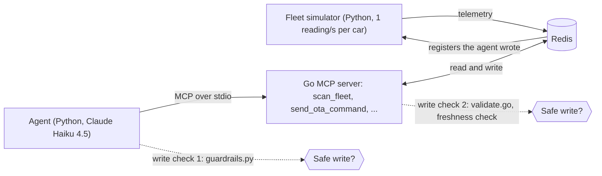

# Fleet MCP Platform

[](https://github.com/vipin-mo/fleet-mcp-platform/actions/workflows/ci.yml)

A Claude agent watches a **simulated** 100-vehicle telemetry stream, finds battery and cabin faults, applies
a (simulated) over-the-air fix, and checks that the fix worked. It talks to the fleet through a Go server
that speaks the [Model Context Protocol](https://modelcontextprotocol.io) (MCP). A seeded fault simulator
and a ground-truth scoring script measure how often it gets this right.

**Result:** on 20 randomized fleets the agent fixed 43 of 43 injected faults and made no write to a healthy
vehicle (20 of 20 runs passed, 95% interval 84% to 100%). A rule-based agent with no model passes the same
cases, 20 seconds faster and with no tokens, so those cases test the safety layers and the detector, not the
model. On a fault whose fix is written only in the maintenance manual, the rules passed 0 of 6 runs and Claude
6 of 6. See [Results](#results) and [Claude versus rules](#claude-versus-a-rule-based-agent).

This is a portfolio project, not production software. The fleet is a Python simulator, "OTA" means writing
a field in a Redis hash, and Redis is a single container.

## How it fits together



The simulator reacts to the registers the agent writes, so a fix really changes the data and the agent can
verify it. The agent's loop: scan the whole fleet, look up the cause in the maintenance manual, write the
approved fix for each flagged vehicle, wait 8 s, scan again, and report each vehicle as RESOLVED or UNRESOLVED.

## Safety

The model can produce bad tool calls and the feed can go quiet, so the checks do not depend on the prompt.

**Write validation, two layers.** `agent-client-python/guardrails.py` runs before a call leaves the agent;
`mcp-server-go/server/validate.go` runs again inside the server. Rules: device ID `car_` plus three ASCII
digits; `power_parameter` accepts only `eco_mode`; `speed_governor` accepts a whole number from 20 to 60;
every other register is rejected. Both layers pass the same 32 cases in `testdata/ota_cases.json`.
`python scripts/bad_ota_demo.py` shows the server rejecting unsafe calls on its own.

**Stale data, three layers.** A stopped feed must not look like a healthy fleet.

1. `scan_fleet` never analyses a vehicle whose last reading is older than 15 s. If more than half the fleet
   is that old, or no vehicle exists, it returns `feed_status` = `stale` or `empty` and flags nothing.
2. The Python client blocks every `send_ota_command` after a scan that was not `ok`.
3. The Go server refuses to write to a vehicle whose reading is older than 15 s, or has no timestamp.

## The Go server's tools

| Tool | What it does |
| --- | --- |
| `scan_fleet()` | Checks every vehicle (battery trend, cabin status, data age) and returns the ones that need action, plus `feed_status` (`ok`, `stale`, `empty`) |
| `send_ota_command(device_id, parameter, value)` | Writes `power_parameter` or `speed_governor` after validation. Refused on stale data |
| `wait_for_telemetry(seconds)` | Pauses up to 15 s so new readings arrive before a re-check |
| `analyze_anomalies_stats(device_id)` | Detector result for one vehicle |
| `get_historical_logs(device_id)` | Newest 10 readings for one vehicle |
| `get_fleet_snapshot(min_speed, min_temp)` | Vehicles above both thresholds. The agent no longer uses it: it skipped cars below its own filter, so the scan checks everything on the server |
| `search_maintenance_manual(query)` | Returns the fault-code manual (the whole file, whatever the query) |

## The detector

Each vehicle keeps its last 60 readings. The newest 5 are compared with the older ones, never with
themselves (a window that contains the reading limits the z-score to 3 and hides real runaways).

| Classification | Meaning | Agent action |
| --- | --- | --- |
| `sustained_anomaly` | Median of the newest 5 is more than 2.5 standard deviations above the baseline, or at least 60 °C | Fix |
| `rising_trend` | The newest 5 climb faster than 0.3 °C per reading, or the newest reading is high and either the one before it was also high or the readings before it were already climbing | Fix |
| `transient_spike` | One high reading after a normal one, with no climb before it | Ignore |
| `nominal` | Everything else, including cooling after a fix | Nothing |
| `insufficient_data` | Fewer than 15 readings | Wait |

The spread has a floor of 0.5 °C. The slope uses the Theil-Sen estimator (median of pairwise slopes) so one
stray reading does not look like a climb.

On the simulator the detector flags a battery fault when it is about 1.4 °C above normal: about 2 s after a
0.6 °C/s fault begins and 8 to 11 s after a slow 0.15 °C/s one. It raised no alarm on 4,000 healthy readings
or on 70 sensor blips. The table, and a bug this test found, are in [docs/DETECTION_LATENCY.md](docs/DETECTION_LATENCY.md).

## Run it

Needs Docker, Go (version in `mcp-server-go/go.mod`), Python 3.11+, and an Anthropic API key for the Claude agent.

```bash
cp .env.example .env                                  # add ANTHROPIC_API_KEY
python -m venv .venv && source .venv/bin/activate
pip install -r agent-client-python/requirements.txt -r requirements-dev.txt

make up                                               # Redis (this machine only)
make simulator ARGS="--fault-start-tick 20"           # terminal 1: faults begin after 20 s
make run                                              # terminal 2: start after the faults begin
```

No API key? `python agent-client-python/baseline_agent.py` runs a rule-based agent on the same tools.

## Tests

```bash
make test      # go vet, go test, pytest. No Redis, Docker or API key needed.
make latency   # detector speed table
```

CI runs the same checks on every push and pull request. The tests cover the detector (including the
simulator's own series), the simulator physics, the Redis writer (in-memory Redis), both write checks, the
agent loop (fake model, fake server), the scorer, and the rule-based agent. They do not call the model.

## Evaluation

`make eval ARGS="--runs 20"` runs the Claude agent against 20 seeded fleets (about 20 minutes, needs an API
key) and scores each run against the simulator's ground truth. The score reads what the agent did and what the
server showed it afterwards, not the agent's own report, which can contain wrong numbers. A run passes only
if every fault is fixed, nothing else is written, and a later scan confirms the fix.

Standard suite: random fault layouts, no faults, sensor blips only, five healthy cars going silent, and a
dead feed. `--suite hard` adds a car with both faults, a faulty car that stops reporting, and a slow ramp.
`--suite manual` adds a cabin coolant leak whose fix (a 30 km/h governor, not the usual 50) is only in the manual.
`make eval-baseline` runs the same cases with the rule-based agent, with no key and no cost, to show what the
model adds. See [docs/EVALUATION.md](docs/EVALUATION.md).

## Results

Claude Haiku 4.5, 20 seeded fleets, 2026-10-06 (files in `artifacts/eval_20261006/`).

| Case | Passed |
| --- | --- |
| Random faults (0-3 battery, 0-3 cabin, 0-3 sensor blips) | 12 / 12 |
| No faults | 2 / 2 |
| Sensor blips only | 2 / 2 |
| 5 healthy cars stop reporting | 2 / 2 |
| Whole feed dead | 2 / 2 |

- 20 of 20 runs passed (95% interval 84% to 100%). 43 of 43 injected faults fixed. No write to a healthy,
  blip or silent car.
- Median 6 turns, 20.9k input tokens and 26 s per run.
- Limits: one model, one run per seed. The simulator, detector and scorer were written by the same person.
  This run happened before a fix to the lone-spike rule (docs/DETECTION_LATENCY.md). Repeated on 2026-10-24
  with the fixed detector on the same 20 seeds: 20 of 20 passed, 43 of 43 faults fixed, no false action,
  median 21.5k input tokens and 24 s (`artifacts/eval_rerun_llm_20261024/`).

### Claude versus a rule-based agent

Both agents ran the same seeded cases with the same tools, write checks and scorer
(`artifacts/eval_rerun_llm_20261024/`, `artifacts/eval_baseline_20261009/`, `artifacts/eval_hard_baseline_20261009/`,
`artifacts/eval_hard_llm_20261009/`, `artifacts/eval_manual_baseline_20261024/`, `artifacts/eval_manual_llm_20261024/`).

| Suite | Agent | Runs passed | Faults fixed | Input tokens per run (median) | Seconds per run (median) |
| --- | --- | --- | --- | --- | --- |
| Standard, 20 fleets | Claude Haiku 4.5 | 20 / 20 | 43 / 43 | 21.5k | 24 |
| Standard, 20 fleets | Rules | 20 / 20 | 43 / 43 | 0 | 8 |
| Hard, 12 fleets (dual fault, silent faulty car, slow ramp) | Claude Haiku 4.5 | 12 / 12 | 45 / 45 | 25.5k | 30 |
| Hard, 12 fleets | Rules | 12 / 12 | 45 / 45 | 0 | 8 |
| Manual-only, 6 fleets (coolant leak next to ordinary cabin and battery faults) | Claude Haiku 4.5 | 6 / 6 | 30 / 30 | 28.4k | 32 |
| Manual-only, 6 fleets | Rules | 0 / 6 | 20 / 30 | 0 | 8 |

- On the standard and hard suites the model adds no accuracy. It adds about 20 seconds and 20k to 25k input
  tokens per run (8 s of the rule agent's time is the fixed wait after a fix).
- The detection and the stale-data checks live in the Go server, so rules can act on what `scan_fleet` returns.
  That is a design choice, and it is why both agents pass.
- 12 of 12 still allows a true pass rate near 76%, so those runs cannot rank the two agents.
- The manual-only suite adds a cabin status, `coolant_leak`, whose fix (speed governor 30 km/h) appears only in
  `vehicle_fault_manual.md`. The system prompt still lists only the two original fixes, and a 50 km/h governor
  does not clear the leak. In every run Claude searched the manual and wrote 30 to each leaking car and 50 to
  each ordinary cabin fault. The rules fixed the faults they know and left every leaking car alone.
- That gap is by construction: the rules have no entry for the new code, and adding one is a one-line change.
  What the suite shows is that the agent follows a manual it was not told about in the prompt. 6 of 6 still
  allows a true pass rate near 61%.
- The model also writes a report. Its numbers were sometimes wrong, so the scorer ignores them. The rules'
  report is exact but short.

## What went wrong along the way

- The first detector compared each reading with a window containing it, so its z-score could never pass 3
  and it could not tell a runaway from noise. It now compares the newest readings with older ones.
- The first write check accepted `"car_012\n"` and full-width digits, and crashed on `"²"`. The shared test
  cases found it.
- A real ramp was read as a one-reading spike when the ramp had already raised the baseline. A slope check
  fixed it. Later a noisy blip was read as a ramp (5 of 70 simulated blips). The slope now ignores the newest
  reading.
- The agent wrote to vehicles on 19-second-old data although the prompt said not to. The check moved into code.
- In 2 of 6 early runs the agent missed faulty batteries (one below its own 40 °C pre-filter, one that its own
  query had returned) and still reported success. The scan moved onto the server, so it covers every car.

## Limitations

- The fleet is simulated, and the detector is tuned to the simulator's noise, not to real battery data.
- One Redis container, one agent, no password on Redis (it listens on this machine only).
- `search_maintenance_manual` is not a real search.
- Agent decisions depend on the model. The unit tests do not cover them; `make eval` does, with a small sample.
- Only one manual-only fault exists, and the same person wrote it, the manual entry and the scorer. A harder
  test would use manual entries the author did not write, or a manual that contradicts the prompt.

## Layout

```
agent-client-python/   Claude agent, rule-based agent, write check, error messages, tests
mcp-server-go/         MCP server: detector, scan, validation, handlers, tests
fleet-simulator/       fault physics, layouts, Redis writer, tests
scripts/               eval runner and scorer, series generator, bad-write demo
testdata/              shared write-check cases, simulator series for the detector tests
artifacts/             sample ledgers and evaluation results
docs/                  evaluation guide, detector latency
```