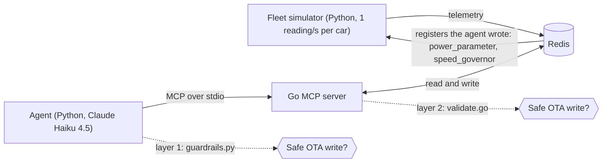

# Fleet Orchestration with an MCP Agent

[](https://github.com/vipin-mo/Bounded_IoT_Fleet_Orchestration_Platform_MCP_Stack/actions/workflows/ci.yml)

A Claude agent watches a **simulated** 100-vehicle telemetry stream, finds battery and cabin faults,
applies a (simulated) over-the-air fix, and then checks that the fix worked. The agent talks to the
fleet through a Go server that speaks the [Model Context Protocol](https://modelcontextprotocol.io) (MCP).

This is a portfolio project, not production software. The fleet is a Python simulator, "OTA" means
writing a field in a Redis hash, and Redis is a single container.

## How it fits together



The simulator reacts to the registers the agent writes, so a fix really changes the data and the
agent can verify it.

## Scenarios (fault cars are fixed, faults start 60 s in)

| Cars | Scenario | Correct agent action |
| --- | --- | --- |
| `car_012`, `car_035` | Battery heats about 0.6 °C per second | `power_parameter = eco_mode`, then confirm the battery is cooling |
| `car_068`, `car_088` | Cabin `overheating_critical` and speeding | `speed_governor = 50`, then confirm the status is `nominal` |
| `car_020`, `car_050` | One hot reading every 20 s (sensor blip) | Do nothing |
| everyone else | Healthy | Do nothing |

### Test layouts

`--profile` chooses which cars are faulty, so a result is not tied to four hard-coded car numbers:

| Profile | Cars |
| --- | --- |
| `default` | The original fixed cars (table above) |
| `random` | A new layout for every seed: 0 to 3 battery faults, 0 to 3 cabin faults, 0 to 3 sensor blips, at least one real fault |
| `none` | No faults at all (checks for false alarms) |
| `spikes_only`, `battery_only`, `cabin_only` | One kind of fault, 1 to 3 cars |

Two more switches test bad data: `--silent-cars N` makes N healthy cars stop reporting when faults
start, and `--freeze-after TICK` stops all writes (the process keeps running, so Redis keeps the
ageing data, as in a real outage). `--manifest FILE` saves the ground truth (which cars are faulty).

## Tools the Go server exposes

| Tool | What it does |
| --- | --- |
| `scan_fleet()` | Checks every vehicle on the server (battery trend, cabin status, data age) and returns only the ones that need action, plus `feed_status` (`ok`, `stale` or `empty`). The agent calls this first and again after each fix. |
| `get_fleet_snapshot(min_speed, min_temp)` | Vehicles above both thresholds, with their current registers. Reads one Redis set and one pipelined batch. |
| `get_historical_logs(device_id)` | The newest 10 readings for one vehicle. |
| `analyze_anomalies_stats(device_id)` | Compares the newest readings with the vehicle's own earlier readings and returns a classification. |
| `search_maintenance_manual(query)` | Returns the fault-code manual. It currently returns the whole file whatever the query. |
| `send_ota_command(device_id, parameter, value)` | Writes `power_parameter` or `speed_governor` after validation. Refused if the vehicle's last reading is older than 15 s. |
| `wait_for_telemetry(seconds)` | Pauses up to 15 s so new readings arrive before a re-check. |

## Stale data

A stopped feed must not look like a healthy fleet. Three layers handle it:

1. `scan_fleet` never analyses a vehicle whose last reading is older than 15 s. If more than half the
   fleet is that old, or no vehicle exists, it returns `feed_status` = `stale` or `empty` and flags nothing.
2. The Python client blocks every `send_ota_command` after a scan that was not `ok`.
3. The Go server refuses to write to a vehicle whose reading is older than 15 s (or has no timestamp),
   even if a client skips the first two layers.

The prompt tells the agent to report `STALE TELEMETRY`, but nothing relies on the prompt alone: in an
earlier run the agent ignored that rule on 19-second-old data and wrote to the vehicles.

## The detector

Each vehicle keeps its last 60 readings. The newest 5 are compared with the older ones, never with
themselves. Comparing a reading with a window that contains it limits the z-score (with 10 points
it can never exceed 3), so a real runaway could not be told from noise.

| Classification | Meaning | Agent action |
| --- | --- | --- |
| `sustained_anomaly` | Median of the newest 5 is above 2.5 standard deviations (or above 60 °C) | Mitigate |
| `rising_trend` | Steady climb, or two high readings in a row | Mitigate |
| `transient_spike` | One high reading after a normal one | Ignore |
| `nominal` | Everything else, including cooling after a fix | Nothing |
| `insufficient_data` | Fewer than 15 readings | Wait |

The baseline spread has a floor of 0.5 °C so a very quiet sensor does not turn a 1 °C wiggle into a
huge score. The slope uses the Theil-Sen estimator (median of pairwise slopes) so one stray reading
does not look like a climb.

## Two safety layers

The model can produce bad tool calls, so writes are checked twice:

1. `agent-client-python/guardrails.py` runs before the call leaves the agent.
2. `mcp-server-go/server/validate.go` runs again inside the server, so a client that skips layer 1
   still cannot write an unsafe value.

Rules: device ID `car_` plus exactly three ASCII digits; `power_parameter` accepts only `eco_mode`;
`speed_governor` accepts a whole number from 20 to 60; every other register is rejected. Both
layers are tested against the same file, `testdata/ota_cases.json`. Run
`python scripts/bad_ota_demo.py` to watch the server reject unsafe calls on its own.

## Run it

Needs Docker, Go 1.25+, Python 3.11+ and an Anthropic API key.

```bash
cp .env.example .env                                  # add ANTHROPIC_API_KEY
python -m venv .venv && source .venv/bin/activate
pip install -r agent-client-python/requirements.txt -r requirements-dev.txt

make up                                               # Redis
make simulator                                        # terminal 1: faults begin after 60 s
make run                                              # terminal 2: start after the faults begin
```

Use `make simulator ARGS="--fault-start-tick 20"` for a faster demo, or `--seed N` for a different run.

## Tests

```bash
make test      # go vet, go test, pytest. No Redis, Docker or API key needed.
```

CI runs the same checks on every push and pull request. The tests cover the detector maths, the
simulator physics, the Redis writer (with an in-memory Redis) and both safety layers. They do not
call the model, so agent behaviour is checked by running it.

## Evaluation

`make eval ARGS="--runs 20"` runs the real agent against 20 different simulated fleets and scores each
run against the simulator's ground truth. It needs Redis (`make up`), an API key, and about 20 minutes.

| Case kind | What it checks |
| --- | --- |
| `random` (half the suite) | Every faulty car is fixed, nothing else is touched, the fix is confirmed by a later scan |
| `none` | No fault: the agent must write nothing |
| `spikes_only` | Only sensor blips: the agent must write nothing |
| `silent` | Five healthy cars stop reporting; the faults on other cars must still be fixed and the silent cars left alone |
| `freeze` | The whole feed dies with faults visible in the old data: the agent must write nothing and report stale telemetry |

A run passes only if all its checks hold. The score reads what the agent did (the writes that
succeeded in the ledger) and what the server showed it afterwards, not the agent's own report, which
can contain wrong numbers. Cases that fail for setup reasons (the agent never started) are listed as
`INVALID` and are not counted as passes or failures. The summary gives the pass rate with a 95%
interval: with 20 runs that interval is wide, and it is the number to quote.

`python scripts/eval_runs.py --score-ledger logs/<file>.jsonl --expect default --session-start 2026-10-06T18:37`
scores runs you already made.

## Audit ledger

Every run appends to `logs/fleet_agent_ledger_YYYY-MM-DD.jsonl`: each model turn (with token counts),
each tool request and response, and each guardrail rejection. A sample from an earlier version is in
`artifacts/`.

## Results (Claude Haiku 4.5, 20 seeded fleets, 2026-10-06)

| Case | Passed |
|---|---|
| Random faults (0-3 battery, 0-3 cabin, 0-3 sensor blips) | 12 / 12 |
| No faults | 2 / 2 |
| Sensor blips only | 2 / 2 |
| 5 healthy cars stop reporting | 2 / 2 |
| Whole feed dead | 2 / 2 |

- 20 of 20 runs passed (95% interval 84% to 100%). 43 of 43 injected faults fixed.
  No write to a healthy, blip or silent car.
- Median 6 turns, 20.9k input tokens and 26 s per run.
- A pass needs every fault fixed, no other writes, and a later scan showing the fix.
  The agent's own report is not used for scoring.
- Limits: one model, one run per seed, one day.

## Limitations

- The fleet is simulated, and the detector is tuned to the simulator's noise, not to real battery data.
- One Redis container, one agent, no authentication on Redis.
- `search_maintenance_manual` is not a real search yet.
- Agent decisions depend on the model; the unit tests do not cover them. `make eval` does, with a small sample.
- The simulator, the detector's settings and the scoring were written by the same person. A different fault shape (for example a slow, noisy ramp) may behave differently.
