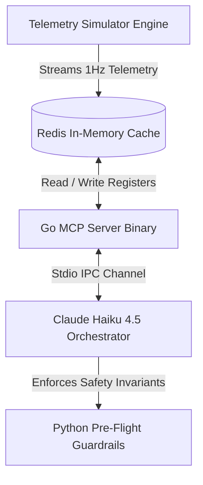

# Bounded IoT Fleet Orchestration Platform (MCP Stack)

[](https://go.dev)
[](https://python.org)
[](https://redis.io)

A production-grade, closed-loop automated vehicle remediation framework powered by the **Anthropic Model Context Protocol (MCP)**. This system integrates an intelligent LLM Orchestrator with a low-allocation Go telemetry runtime and an in-memory Redis cluster. It evaluates streaming multi-variable telemetry data, executes statistical outlier detection, and enforces over-the-air (OTA) hardware mitigation policies in real-time.

---

## Architectural Topology



*   **AI Agent Orchestrator (Python)**: Drives the deterministic 5-step operational protocol using the `claude-haiku-4-5` engine. Handles multi-turn contextual reasoning, identifies pattern intersections, and constructs detailed markdown compliance ledgers.
*   **MCP Infrastructure Engine (Go)**: High-performance, zero-allocation microservices boundary translating raw hardware payloads into type-safe JSON-RPC schemas via structured Stdio transport pipelines.
*   **Transient State Cache (Redis)**: Implements highly optimized data layouts. Telemetry registers are kept inside discrete Hash keys (`device:car_XXX`), and timeline sequences are managed inside atomic, trimmed lists (`logs:car_XXX`) to maintain constant-time $O(1)$ memory windows.
*   **Hardware Simulator (Python)**: Generates concurrent 1Hz telemetry heartbeats across a 100-vehicle fleet while dynamically injecting stress vectors to simulate hardware faults.

---

## Safety Protocols & Remediation Invariants

The platform enforces strict operational boundaries to isolate distinct systemic hardware fault modes:

### 1. Battery Thermal Runaway (`ERR_BATT_THERMAL_RUNAWAY`)
*   **Trigger Condition**: Rolling window statistical outlier validation returning a temperature **Z-Score > 2.5**.
*   **Remediation Loop**: Deploys an OTA modification setting `power_parameter` to `eco_mode` to throttle continuous current draw and drop thermodynamic dissipation rates.

### 2. Cabin Overheating Critical (`ERR_CABIN_OVERHEATING_CRITICAL`)
*   **Trigger Condition**: Intersection of active `overheating_critical` cabin state registers with sustained vehicle speed spikes.
*   **Remediation Loop**: Immediately forces a `speed_governor` override set to **50 km/h** to decrease climate control inverter load patterns.

### Dual-Layer Defensive Engineering
To guarantee hardware integrity, the Python client runs an independent **Pre-Flight Validation Pipeline** using strict regular expressions and localized range filters. If the LLM orchestrator generates an out-of-bounds register write, the Python runtime intercepts and drops the request before it can reach the Go communication path or execute database mutations.

---

## Unified Tool Ecosystem Matrix

The Go server dynamically constructs and presents compliant `jsonschema` structures during initial capability exchange:

*   `get_fleet_snapshot(min_speed, min_temp)`: Performs high-throughput data filtering across active Redis hash regions to parse hardware tracking profiles.
*   `get_historical_logs(device_id)`: Extracts trailing rolling telemetry buffers to evaluate persistent micro-trends versus short-term spikes.
*   `analyze_anomalies_ml(device_id)`: Executes online calculations of rolling arithmetic mean and standard deviation over real-time tracking queues to generate accurate Z-score indexes.
*   `search_maintenance_manual(query)`: High-reliability relative documentation store lookup that streams exact fault code policies back to the agent engine.
*   `send_ota_command(device_id, parameter, value)`: Directly modifies specified low-level vehicle registers (`power_parameter` / `speed_governor`) within the transactional cluster layer.

---

## Execution & Verification Run

### Operational Prerequisites
Ensure you have Docker, Go (v1.25+), and Python 3.10+ wired into your workspace path.

```bash
# 1. Spin up the underlying database infrastructure
make up

# 2. Boot the operational vehicle network stream
make simulator

# 3. Compile the Go binary and activate the AI Orchestrator Loop
make run
```

### Build and Workspace Maintenance
```bash
# Flush temporary python artifacts, cache targets, and compiled server assets
make clean

# Flush local transactional audit ledger tracks
make clean-logs
```